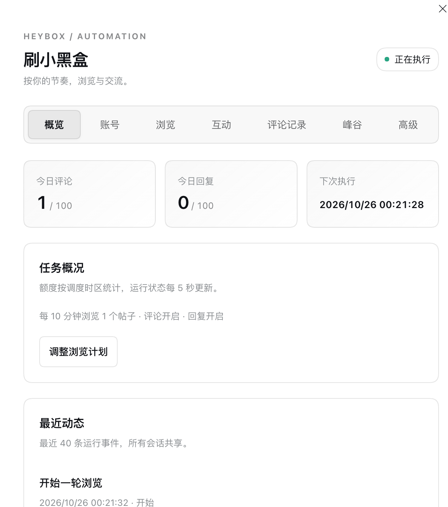
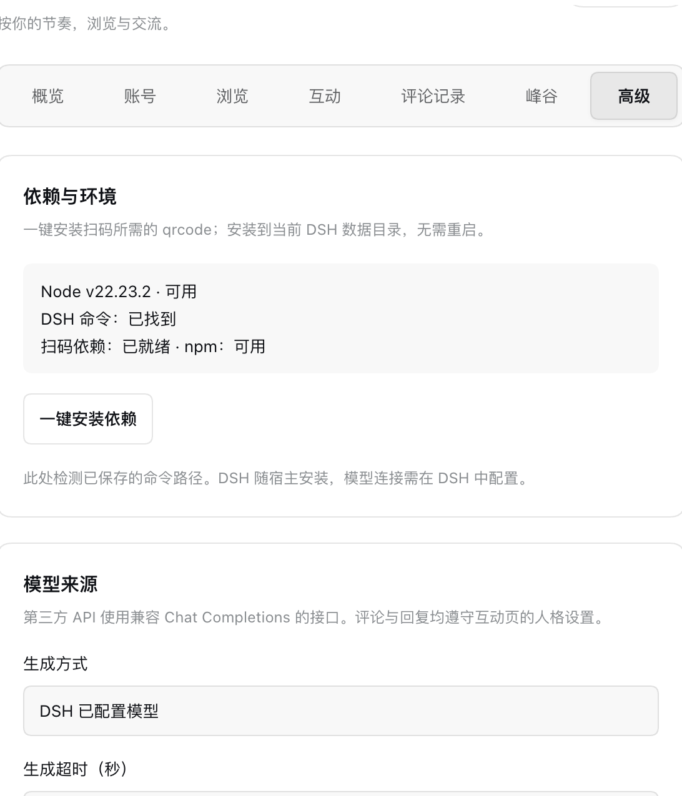

# DSH · 刷小黑盒

基于 DeepSeek Harness 的小黑盒后台浏览与互动插件。界面参考 [dsh-bili-scroll](https://github.com/c1overzz/dsh-bili-scroll)：在 DSH **设置 → 刷小黑盒** 配置任务，在会话的 **刷过的帖子** 标签查看最近浏览记录。不使用侧栏、悬浮胶囊或遮罩面板。

当前版本：0.10.3。需求分析见 [自动化设计](docs/automation-design.md)，实现和联调结果见 [开发记录](docs/development.md)。双插件历史与升级见 [历史隔离](docs/history-and-upgrades.md)，官方发现机制见 [插件发布](docs/plugin-discovery.md)。

## 安全与隐私

**本插件在你自己运行 DSH 的主机上执行，账号配置与浏览历史保存在该主机，不需要开发者托管服务。经 2026-10-26 对本仓库自有源码的人工检查，未发现恶意代码、隐藏数据上报、遥测、挖矿或远程控制逻辑；未发现将 Cookie、API 密钥或浏览历史上传到插件开发者服务器的代码。** 详细范围、代码依据和本次加固见 [代码安全审查](docs/security-review.md)。这是对当前源码的检查结果，不是第三方安全认证或“绝无漏洞”的保证。

这里的“本地运行”指 **DSH 宿主所在机器**：DSH 装在个人电脑上，数据就保存在电脑；DSH 装在你自己的云服务器上，数据就保存在那台服务器。通过浏览器修改设置时，配置会发送给你自己的 DSH 宿主。

插件需要联网完成小黑盒和模型功能，数据流向如下：

| 场景 | 连接对象与发送内容 |
| --- | --- |
| 登录、浏览、评论和回复 | 请求小黑盒官方 `api.xiaoheihe.cn`，按接口需要携带账号 Cookie、帖子 / 评论 ID 和待发送的正文 |
| 图片加载 | 由宿主代理请求 `xiaoheihe.cn` / `max-c.com` 及其子域，图片代理不附带账号 Cookie；拒绝自动跳转 |
| DSH 模型生成 | 使用你在 DSH 配置的模型，将人设及本次帖子 / 评论上下文交给该模型；远程模型服务会接收这些内容 |
| 自定义第三方 API | 仅在选择该方式后，请求你填写的 API 地址，发送模型名、人设、帖子 / 评论上下文及该 API 的认证密钥；远程地址必须使用 HTTPS |
| 一键安装扫码依赖 | 按宿主 npm 源配置下载 `qrcode@1.5.4` 及其依赖，安装在自己的 DSH 数据目录，禁用依赖安装脚本 |

账号 Cookie 与第三方 API 密钥不会加入模型提示词；Cookie 不通过插件状态接口返回浏览器，保存后的 API 密钥也不通过配置查询返回。扫码图片使用本地 `qrcode` 库生成，不使用第三方二维码生成服务。凭据文件保存在磁盘上，采用权限限制，**并非加密存储**；有宿主文件读取权限的人仍可读取。

因此，本插件可以表述为“**由用户自托管运行，无开发者数据收集服务**”，不能表述为“完全离线、任何数据都不会发送到服务端”。总开关、自动评论和自动回复默认关闭，开启后会按你的配置向平台发送请求。DSH 网页访问权限由宿主控制，插件接口不额外提供独立的账号认证；远程部署需为 DSH 本身配置访问控制。

## 界面截图

以下为用户提供的实际运行截图，展示当时的界面与配置，不代表默认额度或默认开关；截图中的“峰谷”“下次执行”在新版中分别显示为“运行时段”“下次调度检查”。

### 任务概览

查看任务状态、今日评论 / 回复额度、调度时间和最近动态，通过顶部 Tab 切换菜单。



### 高级设置

查看宿主环境、一键安装扫码依赖，并选择 DSH 已配置模型或兼容 Chat Completions 的第三方 API。



## 功能

| 功能 | 说明 |
| --- | --- |
| 定时浏览 | 总开关、1–1440 分钟间隔、每轮 1–10 个未读推荐帖 |
| 自动评论 | 独立开关，依据帖子生成评论，可选择作者、自定义用户（ID + 昵称）或不提及；按官方客户端样本生成用户链接，通知效果尚未验证 |
| 自动回复 | 独立开关，只处理能核对为回复自己评论的来信 |
| 发言人格 | 通用人设与独立回复人格，支持多行；回复人格留空沿用通用人设 |
| 评论记录 | 查看当前账号最近 100 条评论 / 回复的正文、来信内容和发送状态，可分类筛选 |
| 依赖安装 | 高级菜单检测环境，一键安装扫码依赖，显示安装进度与结果 |
| 谷时策略 | 可选工作日谷时、周末、节假日和补班日期；时区与窗口可配置 |
| 发送约束 | 每日评论 / 回复额度、共享冷却、账号去重、发送结果未知时不自动重试 |
| 运行记录 | 立即执行、停止、下次调度检查时间、今日额度和最近 40 条事件 |
| 会话标签 | “刷过的帖子”显示当前账号的持久浏览档案，每页 50 帖；所有会话共享 |
| 账号配置 | 小黑盒 App 扫码确认登录，支持刷新 / 取消 / 过期提示；Cookie 输入作为备用，凭据由宿主持有 |

总开关、自动评论和自动回复默认关闭，默认 30 分钟读 1 帖。自动浏览指读取正文，不保证增加平台浏览量。

## 安装

Node 版本需满足已安装 DSH 的要求，开发验证使用 Node 24：

```sh
dsh plugin --profile web add github:fbbDirge/dsh-xiaoheihe
```

重启 DSH Web 并刷新页面，打开 **设置 → 刷小黑盒**。本地开发也可安装仓库目录：

```sh
dsh plugin --profile web add /path/to/dsh-xiaoheihe
```

本插件沿用 `heybox` 包名与配置目录，与其他同名插件应二选一，避免重复挂载。由旧版升级时保留宿主已有的账号和任务配置；旧版的论坛侧栏、搜索、收藏等浏览界面已替换为后台任务配置页。

设置页采用「概览 / 账号 / 浏览 / 互动 / 评论记录 / 运行时段 / 高级」七个顶部 Tab，窄屏可横向滚动菜单。切换菜单保留未保存的修改和扫码状态；底部「保存设置」统一保存所有菜单的配置。概览展示运行状态、今日额度和最近动态。

0.10.0 新增自定义 @ 昵称、第三方模型 API 和独立配置 JSON 编辑，使用方法见 [配置说明](docs/configuration.md)。第三方模型同样使用通用人格 / 回复人格；提及通知仍未完成平台端验证。

0.10.2 将普通 `@昵称` 改为包含 `data-user-id` 与 `openUser` 协议的提及链接。自定义用户需补充数字 ID；旧配置保留，缺少 ID 时跳过发送并记录错误。标记来自用户提供的官方客户端显示样本，实际提交与通知仍需平台联调。

发布新帖、定时发帖和关键词搜图目前尚未实现。参考项目能力、图片上传协议和独立发帖计划见 [发帖调研](docs/posting-research.md)。

会话的“刷过的帖子”需要宿主支持 `conversation.view`；旧版宿主不支持时仍可在设置页查看最近运行记录。

## 使用

1. 打开 **设置 → 刷小黑盒 → 账号 → 扫码登录**，用小黑盒 App 扫描二维码并在手机确认。界面显示等待扫码 / 已扫码待确认，成功后自动保存账号。二维码当前有效期 120 秒，可刷新或取消；需要额外验证的账号会提示使用备用登录。
2. 如扫码不可用，展开 **Cookie 登录（备用）**：在 [小黑盒网页版](https://www.xiaoheihe.cn) 登录，从开发者工具 Network 请求头复制 Cookie 后保存。后台任务需包含可识别的 `heybox_id`；手动保存 Cookie 不代表已验证登录有效性。
3. 在「浏览」Tab 开启“定时浏览总开关”，设置间隔和每轮帖子数，点击“保存设置”。先保持评论 / 回复关闭，用“立即执行一轮”验证读取。
4. 在「互动」Tab 按需开启“自动评论”或“自动回复”，设置额度、冷却和发言人格后保存。「通用人设与兴趣」用于帖子评论；「回复人格」只用于回复评论，留空时沿用通用人设。两项均支持多行，最多 2000 字符。@ 作者会使用作者 ID；自定义 @ 需同时填写昵称和用户 ID。提及链接已按样本生成，通知效果仍待真实账号验证。
5. 在「运行时段」Tab 选择「不限时段 / 峰谷快捷方案 / 峰底快捷方案」，也可直接开启「限制任务开始时段」。工作日、周末、节假日分别编辑时间段，支持多段、跨午夜、全天及当天不运行，无需填写分钟 JSON。快捷方案只填入可修改的预设；峰底示例为每天 00:00–06:00，不代表供应商实际优惠时间。保存后限制任务开始时间，评论和回复发送前会再次检查；已开始的一轮浏览可能延续到时段外。检查间隔在「浏览」中设置，概览的「下次调度检查」不代表一定开始刷帖。
6. 点击“停止任务”停止调度并请求取消当前生成。已提交给平台的请求无法撤回。任务运行中需先停止，等待本轮结束后修改设置。
7. 在「评论记录」Tab 查看本账号最近 100 条发起的评论 / 回复，按「全部 / 帖子评论 / 评论回复」筛选。记录包含实际提交正文（含作者提及）、回复收到的原文、帖子链接及发送状态。升级前未保存的正文无法补回；“已发送”表示平台返回评论 ID，不代表已验证公开可见；结果未知不会自动重发。
8. 在「高级 → 依赖与环境」查看 Node、DSH 命令、npm 与扫码依赖状态。点击「一键安装依赖」将固定版本 `qrcode@1.5.4` 安装到 `$DSH_HOME/heybox/dependencies`，无需重启，进度每 5 秒刷新；切换菜单或关闭网页仍会继续，退出宿主会中止。安装失败可重试，需要宿主有可用的 npm 和网络。DSH 随宿主安装；也可在下方「模型来源」切换第三方 API。

关闭设置页或浏览器不停止任务；DSH Web 宿主必须持续运行，退出宿主后任务停止。不创建系统定时任务。

界面每 5 秒刷新运行状态，不覆盖未保存的表单。会话标签使用独立浏览档案，不随最近运行事件轮转消失；旧版从已保存的帖子 ID / 时间及尚存日志迁移，丢失的旧标题不能补回。自动回复每轮最多检查最近 100 条回复消息，无法确认目标关系时跳过。

默认使用已配置的 DSH `headless` 模型，可先验证：

```sh
dsh --profile headless "只回复测试"
```

高级设置可指定 DSH 命令 / JS 入口和 Node 可执行路径，插件不修改全局 DSH 配置。使用前请确认所选模型可正常响应，并使用自己的账号确认扫码登录与互动效果。自动化测试使用模拟回执，不等同于平台端到端验证。

## 数据与结构

账号 Cookie 保存于 `$DSH_HOME/heybox/state.json`；调度配置、人格和第三方 API 密钥保存在独立的 `$DSH_HOME/heybox/config.json`（权限 0600）；额度、去重、浏览档案及已发起的评论正文保存在 `$DSH_HOME/heybox/automation.json`。旧版首次启动会自动迁移配置，保留任务与历史。本地补装的扫码依赖位于 `$DSH_HOME/heybox/dependencies`。默认 `DSH_HOME` 为 `~/.dsh`。模型提示词不含 Cookie。

- `lib/client.js`：`settings.section` 设置页与可选 `conversation.view` 标签；使用宿主 React，无构建步骤。
- `lib/index.js`：主机签名、Cookie、`/heybox/state`、`/heybox/automation` 等路由；保留原数据接口兼容性。
- `lib/login.js`：官方扫码协议、临时会话、状态轮询和凭据接收；二维码使用本地 `qrcode` 库编码，不依赖第三方二维码服务。
- `lib/dependencies.js`：依赖状态检查、本地 npm 安装与运行时加载；不执行安装脚本，不安装全局包。
- `lib/automation.js`：定时调度、互斥锁、持久化、额度、回复核对和发送。
- `lib/generator.js` / `lib/generation-guard.js`：DSH 结构化生成、取消、超时与工具禁用。
- `cordis.patch.yml`：插件挂载配置。
- `tests/`：签名、设置页 / 会话标签、调度及生成验证。

```sh
npm run check
npm test
```

## 来源与许可

小黑盒数据层来自 [plasta2steel/dsh-xiaoheihe](https://github.com/plasta2steel/dsh-xiaoheihe)，其接口与签名移植自 [WenfuRainbow/heybox](https://github.com/WenfuRainbow/heybox)。设置页入口和后台组织参考 [c1overzz/dsh-bili-scroll](https://github.com/c1overzz/dsh-bili-scroll)。保留原 MIT 许可证与致谢。

非官方项目，平台接口可能变动；数据版权归小黑盒所有。MIT，见 [LICENSE](LICENSE)。
